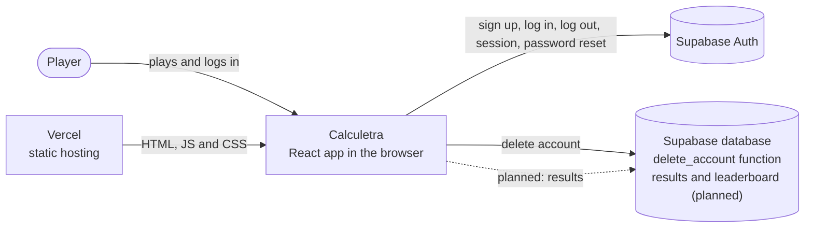
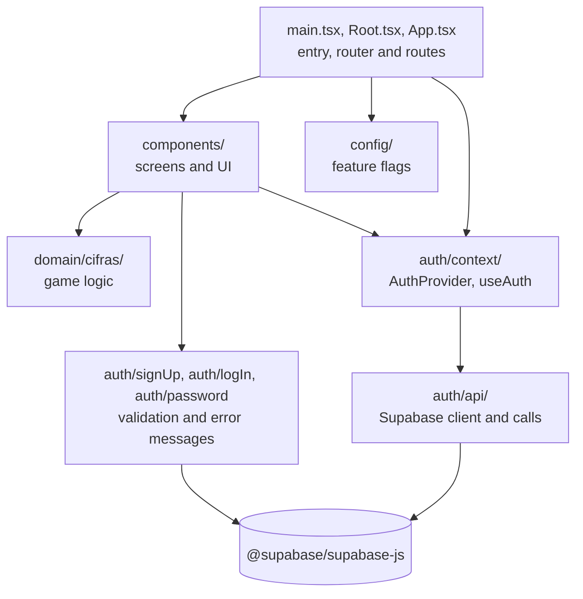

# Architecture

This document explains how Calculetra is built and why: which systems it talks to, where the logic lives and which decisions shape the code. It is meant for anyone who clones the repository and wants to understand it without reading every folder.

It follows a reduced version of the [arc42](https://arc42.org) template: only the sections that are useful for a project of this size, keeping their original numbers.

## 1. Introduction and goals

Calculetra is a daily puzzle inspired by the Spanish TV show *Cifras y Letras*. Every day there is one numbers challenge (**Cifras**), the same for every player. Players can create an account and log in. The letters mode (**Letras**) is not built yet. The home page (`/`) shows the games in a carousel, with the number of today's challenge; Cifras is played at `/cifras`. The rules of the game are in [`docs/rules/cifras.md`](rules/cifras.md).

### Quality goals

| Quality goal | What it means in Calculetra |
| --- | --- |
| Same challenge for everyone, without a server | Every player gets the same numbers and target on the same day. The challenge is calculated in the browser from the date, so no server or database is needed to play. |
| Testable game logic | The rules of the game live in plain TypeScript functions with no React and no network, so every rule can be checked with fast unit tests. |
| Replaceable backend | Only `src/auth` knows about Supabase. Changing provider should not require changes in the components. |

## 3. Context

| Partner | What goes between it and the app |
| --- | --- |
| Player | Uses the app in a browser. The game works without an account. |
| Vercel | Serves the static build (`dist/`). Every page, including `/login` or `/signup`, is answered with `index.html` (see `vercel.json`) so the router in the browser can handle it. Each published release is deployed by the Deploy workflow (see [ADR 0003](decisions/0003-deploy-on-release.md)); merges into main are not deployed on their own. |
| Supabase Auth | Accounts with email and password, called directly from the browser through `@supabase/supabase-js`. See [ADR 0001](decisions/0001-backend-supabase.md). |
| Supabase database | Has one function, `delete_account()`, that lets a logged-in user delete their own account, because the browser key cannot delete users. The SQL is in `supabase/migrations/` and is run by hand in the Supabase SQL Editor. See [ADR 0006](decisions/0006-delete-account.md). Game results, the daily leaderboard and stats are **planned** and not stored yet. |

The daily challenge does not come from any server: see the seeded random in section 4.

## 4. Solution strategy

- **Pure domain logic in `src/domain`.** Generating the challenge, applying an operation, the game state and the score are plain functions. They do not import React or Supabase, so they are easy to test and reuse.
- **Game state as a reducer.** `gameReducer` in `src/domain/cifras/game.ts` receives the current state and an action (`selectTile`, `selectOperator`, `undo`, `reset`, `finish`) and returns the new state. `NumbersGame` only calls it with `useReducer` and draws the result.
- **Seeded random from the date.** `getDailyChallenge` turns the date in the `Europe/Madrid` time zone (for example `2026-10-16`) into a seed with a hash (FNV-1a), and uses it in a seeded generator (Mulberry32). Same date, same seed, same challenge, wherever the player is. The challenge changes at midnight Madrid time.
- **Provider wrapped in `src/auth`.** Components use `useAuth()` and the app's own `AuthUser` type, never Supabase directly. See [ADR 0001](decisions/0001-backend-supabase.md).
- **Build-time feature flags.** `VITE_UNDER_CONSTRUCTION` is read when Vite builds the app. With the flag on, only the "under construction" page is shipped; the game is not even in the bundle.

## 5. Building blocks

| Block | Responsibility | Depends on |
| --- | --- | --- |
| `main.tsx`, `Root.tsx`, `App.tsx` | Start React, choose between the "under construction" page and the app, set up the router and the `AuthProvider`, and define the routes (`/` with the game carousel, `/cifras`, `/signup`, `/login`, `/account`, `/forgot-password`, `/reset-password`, `/privacy`, 404). | `components`, `auth/context`, `config` |
| `components/` | One folder per component with its `.tsx`, CSS Module and test. `HomePage` is the carousel with the Letras, Cifras and Más retos cards; `FloatingTiles` draws the number and letter tiles behind it; `NumbersGame` is the game and `BackToGames` the link back to the home page; `Header`, `SignUpForm`, `LogInForm`, `AccountPage`, `ForgotPasswordForm`, `ResetPasswordPage`, `NewPasswordForm`, `ChangeEmailForm` and `DeleteAccountForm` use the account; `NoticeDialog` shows, in a dialog, a message left by another page. | `domain`, `auth` |
| `domain/cifras/` | Challenge generation and number, seeded random, operations, game reducer and score. | Nothing outside itself |
| `auth/api/` | The Supabase client and the functions `signUp`, `logIn`, `logOut`, `resetPassword`, `updatePassword`, `changeEmail`, `deleteAccount`, `getCurrentUser` and `onAuthChange`. Turns Supabase's user into `AuthUser`. | `@supabase/supabase-js` |
| `auth/context/` | `AuthProvider` keeps the current user and `useAuth()` gives it to components. | `auth/api` |
| `auth/signUp/`, `auth/logIn/`, `auth/password/` | Form validation and translating Supabase errors into messages in Spanish. | `@supabase/supabase-js` (only its error helpers) |
| `config/` | Feature flags read from environment variables. | Nothing |

The arrow from `auth/signUp`, `auth/logIn` and `auth/password` to Supabase is not a break of the rule in section 4: they only use Supabase's error helpers, and they are still inside `src/auth`.

## 8. Cross-cutting concepts

### Testing

- Tests use [Vitest](https://vitest.dev) and live next to the file they test (`game.ts` and `game.test.ts`).
- Domain tests run in Node, with no browser and no network.
- Component tests use [Testing Library](https://testing-library.com) in a `jsdom` environment, chosen per file with `// @vitest-environment jsdom`. They find elements by role and label, as a user would.
- `tests/production-build.test.ts` builds the app and checks that the feature flag ships only the right page.
- CI (GitHub Actions, `.github/workflows/ci.yml`) runs `npm run lint`, `npm test` and `npm run build` on every push to `developer` and on every pull request to `main`.

### Accessibility

- Selected numbers and operators use `aria-pressed`, so screen readers announce which one is selected.
- Groups and lists of the game have an `aria-label` (`Números`, `Operaciones`, `Pasos`, `Resultado`).
- Decorative elements use `aria-hidden="true"`.
- Form fields have a `<label>`, errors use `role="alert"` and confirmations use `role="status"`.
- Animations are turned off with `prefers-reduced-motion: reduce`.
- In the home carousel the dots use `aria-current` for the card in the middle, and the cards that cannot be played yet use `aria-disabled`.

### Styling

- Each component has its own [CSS Module](https://github.com/css-modules/css-modules) (`Component.module.css`), so class names do not clash. `auth/signUp`, `auth/logIn` and `auth/password` share `components/AuthForm.module.css`.
- Global styles and colour tokens (`--color-bg`, `--color-number`, `--color-accent`…) are defined in `src/index.css`. Most components use them; `Header` does not yet.
- The font is Inter, loaded with `@fontsource-variable/inter`.

### Environment variables and feature flags

Vite reads variables that start with `VITE_` from `.env` files and replaces them in the code at build time. They are declared in `src/vite-env.d.ts`.

| Variable | Used for | If it is missing |
| --- | --- | --- |
| `VITE_SUPABASE_URL` | Supabase project URL | `supabaseClient.ts` throws an error and the app does not start. |
| `VITE_SUPABASE_PUBLISHABLE_KEY` | Supabase public key | Same as above. |
| `VITE_UNDER_CONSTRUCTION` | Feature flag: show only the "under construction" page | The flag is off and the app is shown. Only the exact value `true` turns it on. |

Locally the values go in `.env` (copy `.env.example`); in production they are set in Vercel. Both are public values in the browser bundle; the Supabase secret key must never be used here (see [ADR 0001](decisions/0001-backend-supabase.md)).

## 9. Decisions

Decisions are recorded as ADRs in [`docs/decisions/`](decisions/README.md).

| # | Decision | Status |
| --- | --- | --- |
| 0001 | [Use Supabase as the backend](decisions/0001-backend-supabase.md) | Accepted |
| 0006 | [Delete accounts with a database function](decisions/0006-delete-account.md) | Accepted |
